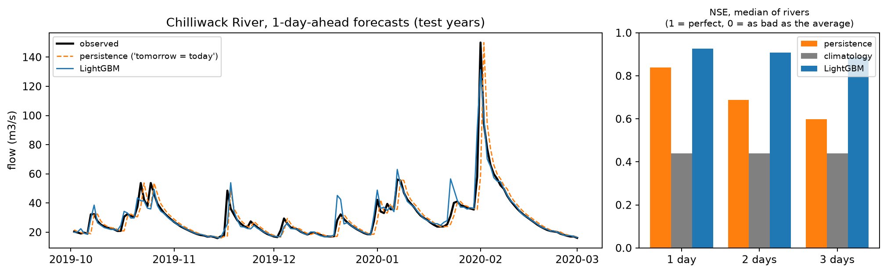
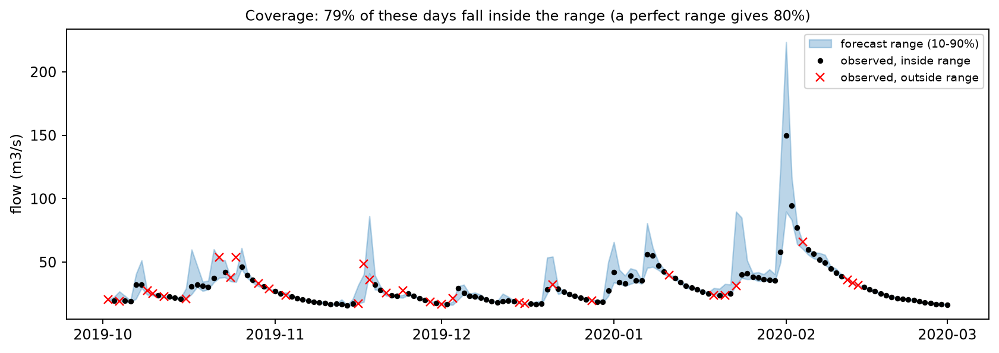
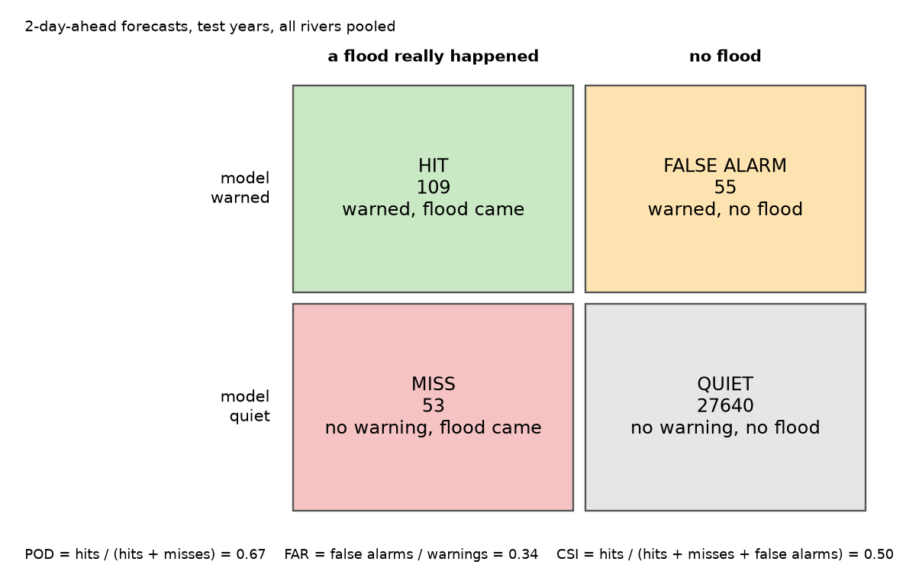
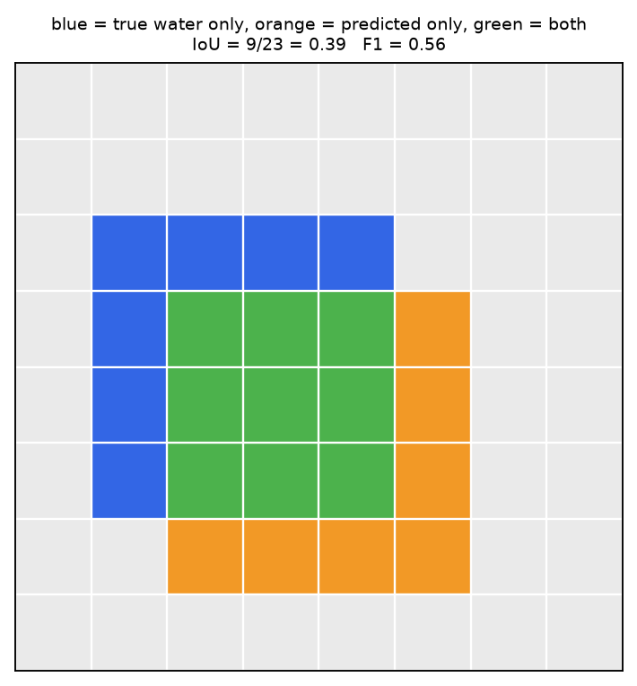
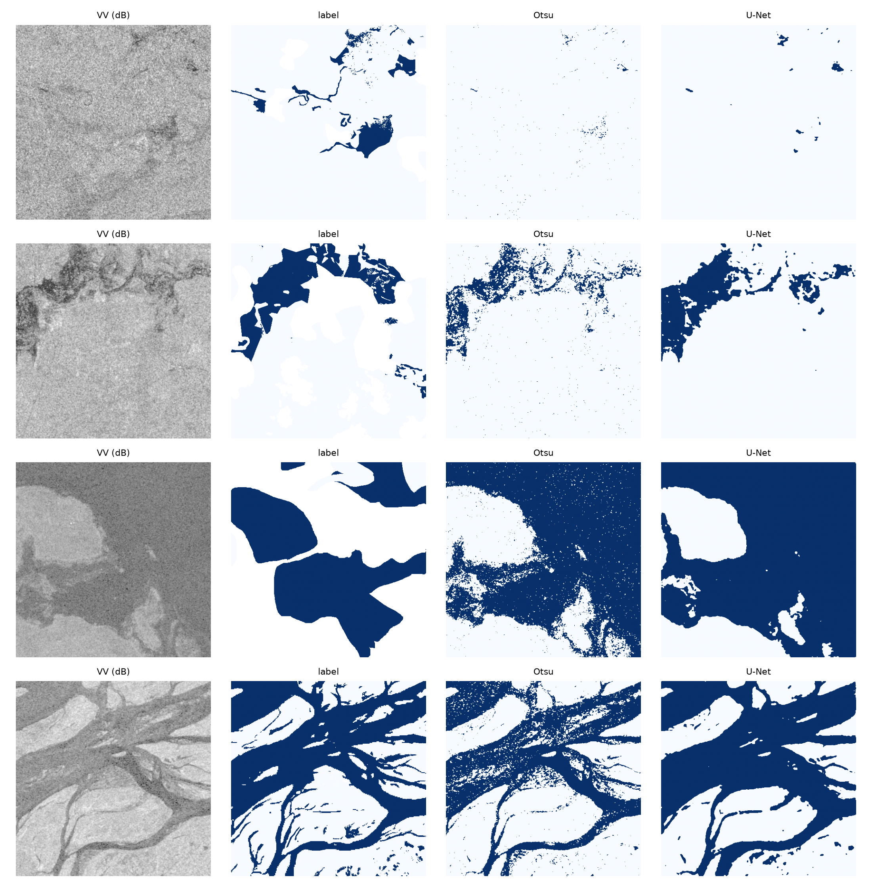
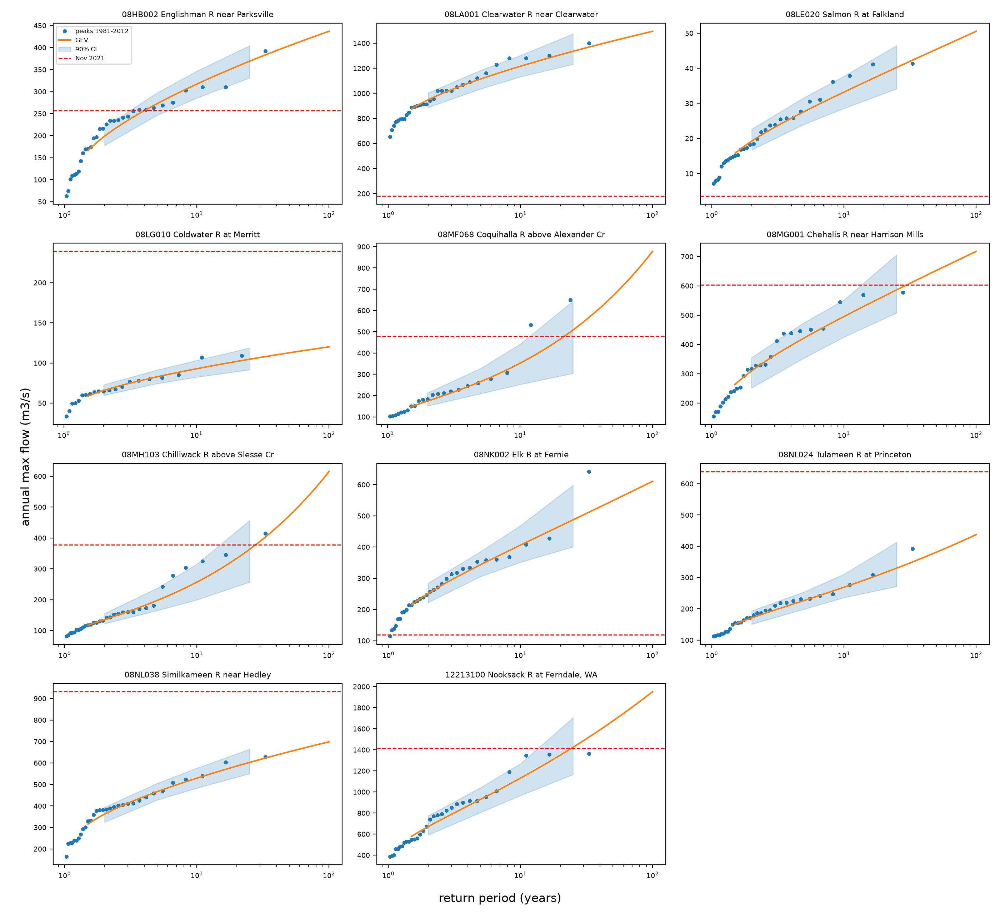

# The scores in this project, explained simply

Every model needs a way to be graded. Here is each score in plain words, with a tiny example, a picture, and where
it is used. The full table with our real results is in [`reports/evaluation_matrix.md`](../reports/evaluation_matrix.md)
(picture: `docs/figures/evaluation_matrix.png`).

**One rule applies to all scores:** they are measured on years the model never saw (2017-2023) or on test images it
never trained on. A score on the training data would be meaningless, like grading a student on the exact
questions they memorised.

---

## 1. Flow forecast scores (Part C)

### Baselines: what must the model beat?
- **Persistence** = "tomorrow will be the same as today". Very hard to beat for tomorrow, but weak for 3 days ahead.
- **Climatology** = "the usual flow for this date of the year".
A forecast model is only useful if it beats both.

### NSE (Nash-Sutcliffe efficiency) - "better than just guessing the average?"
- Range: up to **1 = perfect**. **0 = no better than always guessing the average flow.** Negative = worse than that.
- Toy example: real flows 10, 20, 60, 30. A model that says 12, 18, 55, 33 scores close to 1. A model that always says 30
  (the average) scores 0.
- Because floods are big numbers, NSE mainly rewards getting the **high flows** right.

### KGE (Kling-Gupta efficiency) - "NSE, but also checks bias and spread"
- Range: up to **1 = perfect**. It combines three checks: do the ups and downs match (correlation), is the forecast
  too high or too low on average (bias), and does it vary as much as reality (spread).
- Use it as a second opinion next to NSE.

### Forecast range (10 / 50 / 90%) and coverage
- The model gives **three numbers** for each future day: a low (10%), middle (50%) and high (90%) flow. The middle one
  is the best guess; the range between low and high is the uncertainty.
- **Coverage** asks: how often did reality fall inside the range? A well-calibrated 10-90% range should contain reality
  about **80%** of the time.
- If coverage is lower (ours is about 72-75%), the range is too narrow: the model is a bit overconfident.

---

## 2. Flood warning scores (Part C)

The warning rule: **warn if the high (90%) forecast is above the 5-year flood level**. Then we check, day by day,
what really happened. Four outcomes are possible:

- **POD (probability of detection)** = hits / (hits + misses). "Of all real floods, how many did we warn about?"
  Higher is better. Missing a flood is the costly mistake.
- **FAR (false alarm ratio)** = false alarms / (hits + false alarms). "Of all warnings, how many were false?"
  Lower is better. Too many false alarms and people stop listening.
- **CSI (critical success index)** = hits / (hits + misses + false alarms). One number that punishes both kinds of
  mistake. Higher is better.
- Toy example: 10 real floods, 7 warned (hits), 3 missed, plus 4 false alarms. POD = 7/10 = 0.70,
  FAR = 4/11 = 0.36, CSI = 7/(7+3+4) = 0.50.

### Peak error and timing error
For each flood above the 2-year level: how far off was the forecast **peak size** (in %; negative = forecast too low)
and **peak day** (in days)? Our model gets timing right to about a day but forecasts peaks too low, especially for
record floods like Nov 2021.

### "Days of warning gained" (the headline result)
In the Nov 2021 replay we issue a forecast every day from 8 to 20 November. The first day the warning fires is
compared with persistence (which only warns when the river is already above the level). The difference is how many
days earlier the model warned.

---

## 3. Flood map scores (Part A)

### IoU (intersection over union) - "how much do the maps overlap?"
- Compare the **true water pixels** with the **pixels the model called water**.
- IoU = overlap divided by everything that either of them covers. **1 = identical, 0 = no overlap.**

### F1 - "balance of precision and recall"
- **Precision** = of the pixels called water, how many really are water? (Low precision = lots of false flooding.)
- **Recall** = of the real water pixels, how many did we find? (Low recall = we missed flooded land.)
- **F1** mixes both into one number; 1 is perfect.

### Otsu threshold (the simple baseline)
Radar makes calm water look dark. Otsu picks one darkness cut-off that best separates dark from bright pixels.
The U-Net is only worth it if it beats this simple rule - and it does.

---

## 4. Flood frequency (Part B)

- **Return period** = how rare a flood is. A "10-year flood" has a 1-in-10 chance each year.
- **GEV** is a curve fitted to each river's yearly biggest flows; it lets us read off the 2-, 5-, 10- and 25-year
  flood levels (Q2, Q5, Q10, Q25) with an uncertainty range (bootstrap 90% interval).
- **Rating curve**: a formula that turns flow into water level, so a flow forecast can be shown as a level.
- **Spearman correlation** (flooded area vs river level): do higher levels go with bigger floods? Based on only
  8-9 satellite dates, so it is descriptive and not proof of cause.

---

## 5. Cheat sheet

| If someone asks... | Answer in one line |
|---|---|
| Is the model any good? | It beats "tomorrow = today" at 1, 2 and 3 days (NSE, see matrix), and the gap grows with lead time. |
| Does it warn in time? | In the Nov 2021 replay it warned 3 days before persistence on 4 of 5 rivers, using perfect future weather. For rain-driven rivers it clearly beats persistence; for slow snowmelt floods persistence is about as good (see the by-regime table in `reports/results.md`). |
| What is the weak point? | Record peaks are under-predicted, and the 10-90% range is a bit too narrow. |
| Is the flood map good? | The U-Net beats a threshold on held-out chips; on Sumas Prairie it under-maps the flooded fields. |
| Why trust the scores? | They are computed on years/images the model never trained on, with time-based splits. |
