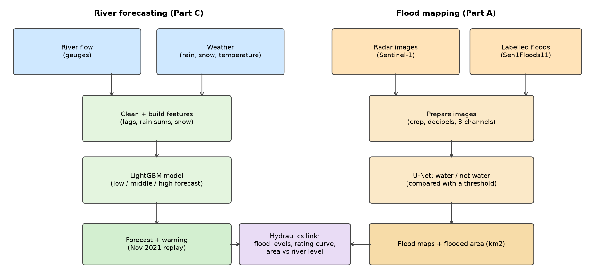
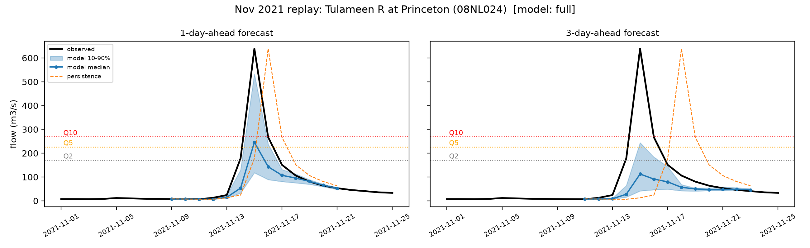
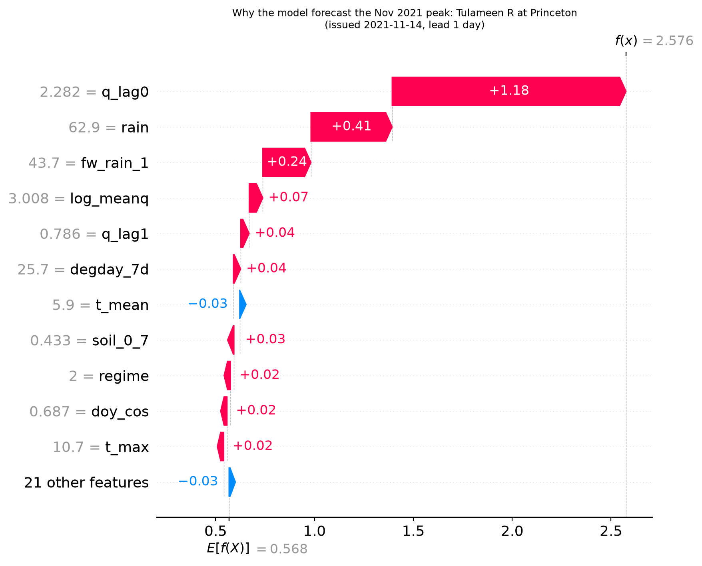
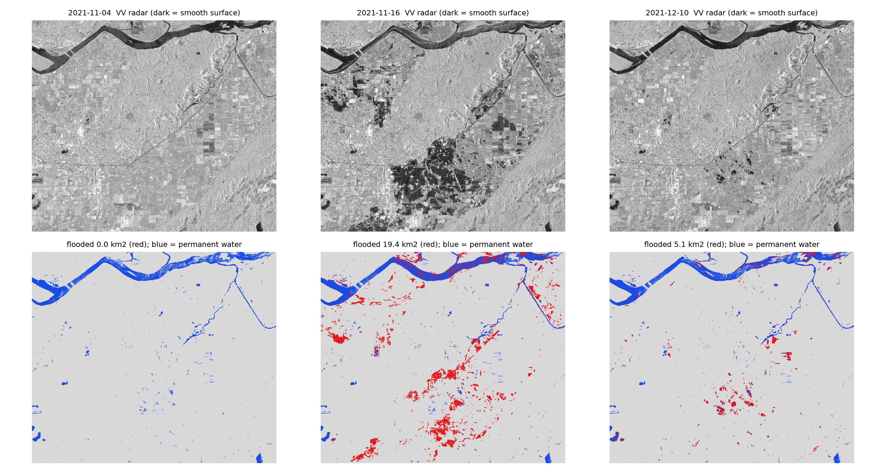
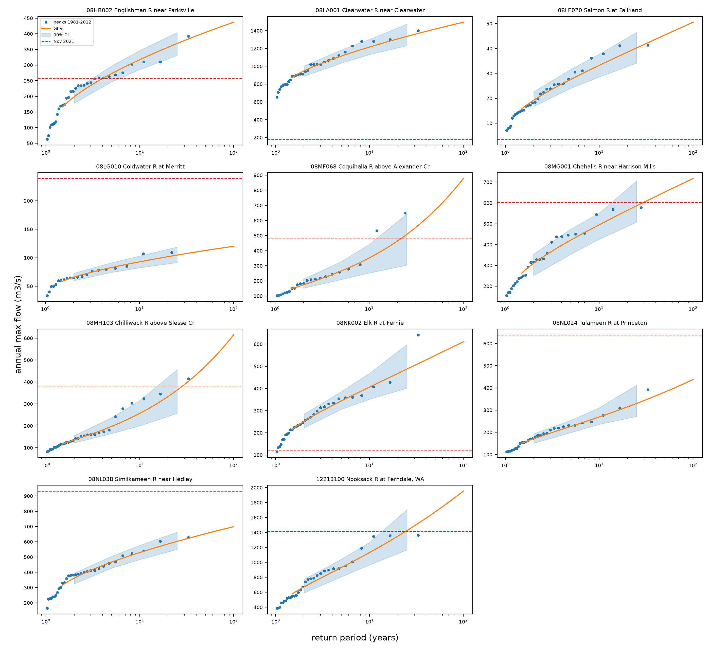
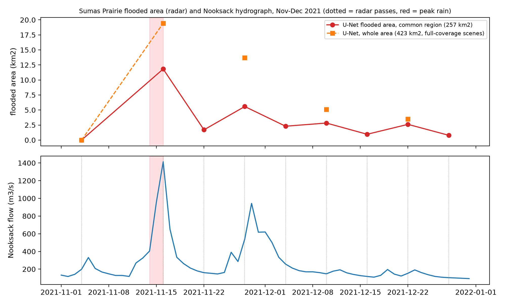

# The whole project, explained simply

Read this top to bottom and you can explain the project to anyone. No hydrology or satellite background needed.
Pictures are from your real results.

---

## 1. The story in one minute

In **November 2021**, a huge storm called an **atmospheric river** (a long river of moist air in the sky, coming from
the Pacific) dumped record rain on southern British Columbia. Rivers rose very fast. A river in the USA, the
**Nooksack**, overflowed into Canada and flooded **Sumas Prairie** (farmland near Abbotsford).

We asked two questions:

1. **Could a computer have warned us a few days earlier?** (forecasting the river flow)
2. **Where exactly was the water?** (finding flooded land from satellite pictures)

Then we added a small third part that connects them: **how rare** was the flood, and how does the flooded area
relate to the river level?



---

## 2. Words you need (the only ones)

| Word | Meaning |
|---|---|
| **Flow (discharge)** | How much water passes a point of the river each second (m3/s). Think: how many bathtubs per second. |
| **Water level (stage)** | How high the water surface is at the measuring station (metres). |
| **Gauge** | The measuring station on the river. |
| **Atmospheric river** | A band of very wet air that brings days of heavy, warm rain. |
| **Rain-on-snow** | Warm rain falling on snow. The snow melts too, so even more water runs off. |
| **5-year flood (Q5)** | A flood size that is reached or beaten on average once every 5 years. Used as our "warning level". |
| **Return period** | How rare a flood is (a 100-year flood has a 1 in 100 chance each year). |
| **Radar (Sentinel-1)** | A satellite that sends its own signal and sees through clouds and at night. |
| **U-Net** | A computer-vision model that colours every pixel of a picture as "water" or "not water". |

---

## 3. Part C: forecasting the river (the main part)

### The idea (an analogy)
Imagine a weather forecaster who only looks at the river. Each morning they check:
*how high is the river now? how much did it rain recently? is there snow on the mountains? how warm is it?
what rain is coming?* Then they say: **"tomorrow the river will be about X, but it could be as low as Y or as high
as Z."** We taught a computer to do this from 40 years of past records.

### What goes in
- **River flow** from 11 river gauges (Canada, plus the Nooksack in the USA), 1980-2023.
- **Weather** for each river (rain, snow, temperature, snow depth, soil wetness) from a public weather record
  called ERA5.
- Simple "features" made from these: flow over the last week, rain over the last 3, 7 and 30 days, whether warm rain
  fell on snow, day of the year, and (as a best case) the real weather of the next 3 days.

### The model
**LightGBM**: a model made of many small decision trees (think: a huge list of "if rain > 50 mm and river already
high, then expect a big rise" rules, learned automatically). One model learns from all rivers at once. It gives
**three numbers**: low (10%), middle (50%) and high (90%). The gap between low and high is the uncertainty.

### The warning rule
> **Warn if the "high" forecast goes above the 5-year flood level.**

### Fair testing (very important)
We trained on **1981-2012**, tuned on **2013-2016**, and tested on **2017-2023**. The model never saw the test years
(including November 2021). Days were never shuffled, so the future never leaked into the past.

### What the forecasts look like
Black = what really happened. Blue = the model's forecast range. Orange dashed = "tomorrow = today".
Notice the model rises *before* the river does:



### Why did the model forecast a big rise? (SHAP)
SHAP shows how much each input pushed the forecast up (red) or down (blue). For the Tulameen peak, the biggest push
is the river already being high, then heavy rain **today (63 mm)** and **tomorrow (44 mm)**:



### Results in plain words
- **Overall accuracy (NSE, 1 = perfect):** the model scores 0.93 / 0.91 / 0.89 for 1 / 2 / 3 days ahead. "Tomorrow =
  today" scores 0.84 / 0.69 / 0.60. The further ahead, the more the model helps.
- **The November 2021 test:** for four of five flood rivers (Coquihalla, Coldwater, Tulameen, Nooksack) the model
  warned **3 days before** the simple method. This used the real weather of the coming days (a best case; real
  forecasts are less accurate). Without it, the gain is only 0-1 days.
- **It is not magic:** for slow snowmelt floods "tomorrow = today" works well, and on the biggest peaks the model
  forecasts too low (for example 360 instead of 932 m3/s on the Similkameen, which got no warning).

---

## 4. Part A: finding the water from space

### The idea (an analogy)
A radar satellite is like a **bat**: it shouts and listens to the echo. **Calm water is like a mirror: the echo
bounces away, so water looks dark.** Land sends echoes back, so it looks brighter. That is why radar can find flood
water, even through clouds.

### What we did
1. **Learn:** we trained a U-Net on about 250 radar pictures where people had already marked the water
   (the Sen1Floods11 collection, floods from around the world).
2. **Compare with a simple rule:** "everything darker than X is water" (called Otsu).
3. **Apply:** we cut big satellite pictures of Sumas Prairie into tiles, let the U-Net colour them, and joined the
   tiles back together.
4. **Subtract what is always water** (rivers, ponds), so what is left is the flood.

### How good is it? (on pictures it never saw)
| Method | IoU (overlap with the truth, 1 = perfect) | F1 |
|---|---|---|
| Simple threshold (per picture) | 0.21 | 0.35 |
| Simple threshold (one global value) | 0.46 | 0.63 |
| **U-Net** (average of 3 training runs) | **0.67** | **0.80** |

### The result on Sumas Prairie
Top: the radar picture (dark = smooth surface = water). Bottom: red = flooded, blue = water that is always there.
Left: before the flood (4 Nov). Middle: just after (16 Nov). Right: after the water drained (10 Dec).



About **19 km2** were flooded on 16 Nov (12 km2 in the region every satellite pass covers), shrinking to about
3 km2 by late December. The U-Net probably **under-counts** the flood (it was trained on floods from other
countries).

---

## 5. Part B: how rare, and how it all connects

### How rare was November 2021?
We fitted a statistical curve (called GEV) to each river's biggest flow of every year (1981-2012). It tells us the
size of a 2-, 5-, 10- and 25-year flood. November 2021 was roughly a **1-in-20 to 1-in-30-year flood** on the
Coquihalla, Chilliwack, Chehalis and Nooksack, and **far rarer than 100 years** on the Coldwater, Tulameen and
Similkameen.



### Flow to water level
For some gauges we fitted a **rating curve** (a formula Q = a x (h - h0)^b) that turns flow into water level, so a
flow forecast can be shown as a level.

### Flooded area and river level
We compared the satellite flooded area with the river on the same day. When the Nooksack and the Sumas River were
high, the flooded area was big. This is a **description from 8-9 dates, not a physical flood model**.



---

## 6. What we are honest about

1. Weather comes from **one point per river** and has no direct atmospheric-river measure (we use "heavy, warm
   rain" as a stand-in).
2. The "future weather" is the **real recorded weather**, so it is a best case.
3. The model **under-predicts record-breaking peaks** (tree models cannot go beyond what they saw). We tried a fix
   (linear-leaf trees): better warnings but not better peaks.
4. The warning scores depend on the river type: rain-driven rivers gain a lot; slow snowmelt rivers gain little.
5. The U-Net is trained on **floods from other countries**, so it misses part of the Sumas flood.
6. The area-versus-level link has only **8-9 satellite dates**.

The full list of problems we hit while building is in [`CHALLENGES.md`](CHALLENGES.md).

---

## 7. Where each thing is

| What | File |
|---|---|
| Overview and results | `README.md` |
| All result tables | `reports/results.md` |
| Every score explained | `docs/METRICS_EXPLAINED.md` and `reports/evaluation_matrix.md` |
| Problems and fixes | `docs/CHALLENGES.md` |
| Short proposal | `docs/PROPOSAL_SUMMARY.md` |
| Code | `src/floodml/`, steps in `scripts/01_...` to `scripts/11_...` |
| Settings | `config.yaml` |

---

## 8. Questions a professor may ask (and short answers)

**Why not just use "tomorrow = today"?**
It is the benchmark we must beat. It is hard to beat for 1 day ahead, but the model clearly wins at 2-3 days (NSE
0.91 and 0.89 versus 0.69 and 0.60).

**Is there leakage?** No. Training, tuning and test years are separate, the flood levels and averages use training
years only, and days were never shuffled.

**Why LightGBM and not an LSTM?** It is fast, works well on tabular data with many rivers, and gives quantile
forecasts easily. An LSTM is planned future work.

**Why did the model miss the Similkameen peak?** The flow of 932 m3/s was far above anything in 1981-2012, and
tree models cannot predict above what they have seen. This is documented, and a model that can extrapolate is the
next step.

**Is the future weather cheating?** It is a perfect forecast, so it shows the best case. We report results with and
without it (without it, 3-day accuracy drops from NSE 0.89 to 0.71, and the 3-day warning score falls to about the
level of "tomorrow = today").

**Why does the U-Net beat the threshold?** The threshold looks only at darkness. The U-Net also looks at the shape
and context of dark areas and at the second radar channel.

**How reliable is the flooded area?** Only roughly. The U-Net under-counts flooded fields and the
area-versus-level link has few dates; we say so.

**What is new here?** Putting river forecasting, satellite flood mapping and flood statistics together for one real
BC event, with honest checks.

**What would you do next?** Real atmospheric-river data (IVT), a multi-basin LSTM, real archived weather forecasts
instead of recorded weather, more floods and basins.

---

## 9. Run it in five lines

```bash
conda activate floodml
python scripts/04_features_models.py    # needs data from steps 01-03
python scripts/05_replay_shap.py
python scripts/07_sumas_maps.py --map   # needs the trained U-Net from step 06
python scripts/09_report.py
```
(The README has the complete list.)
